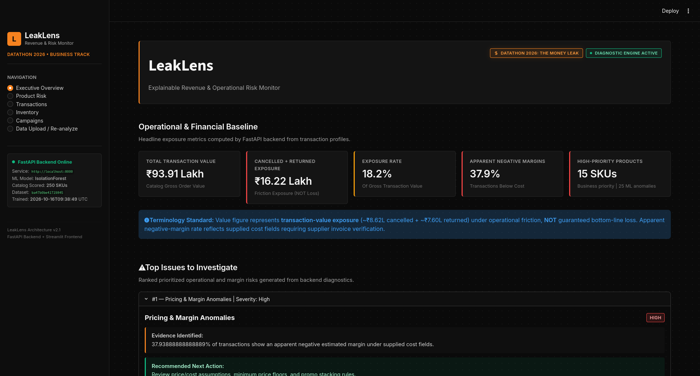
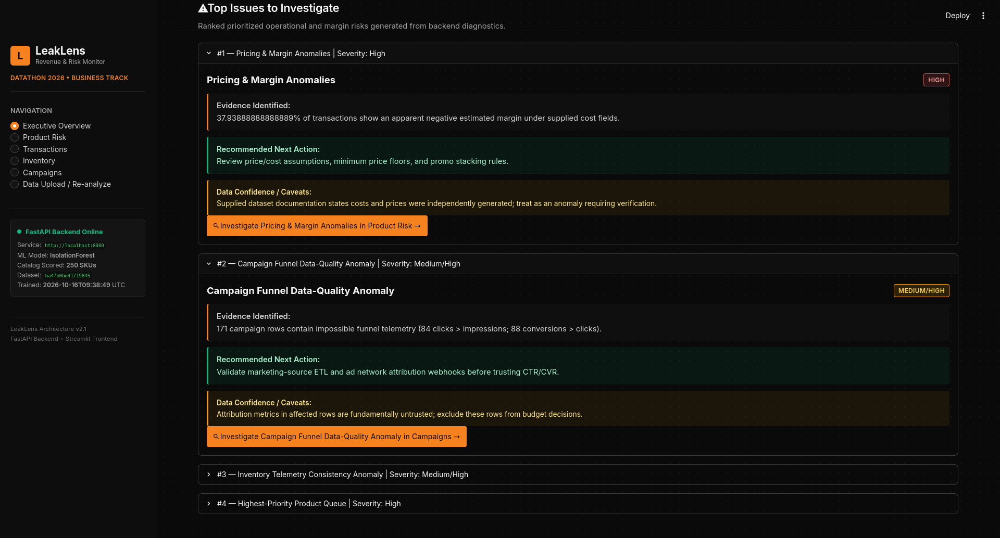
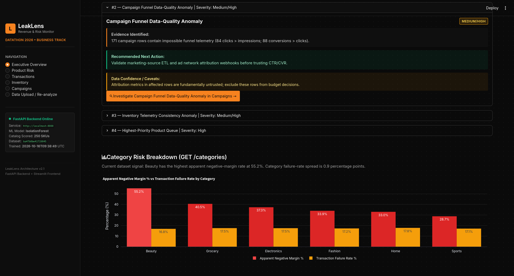
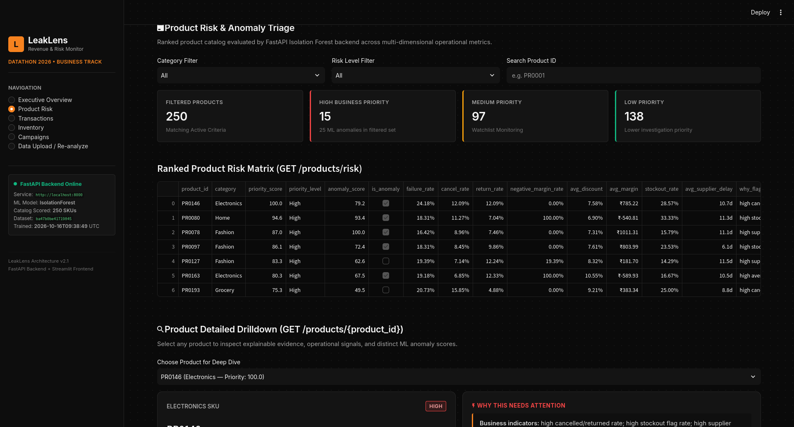
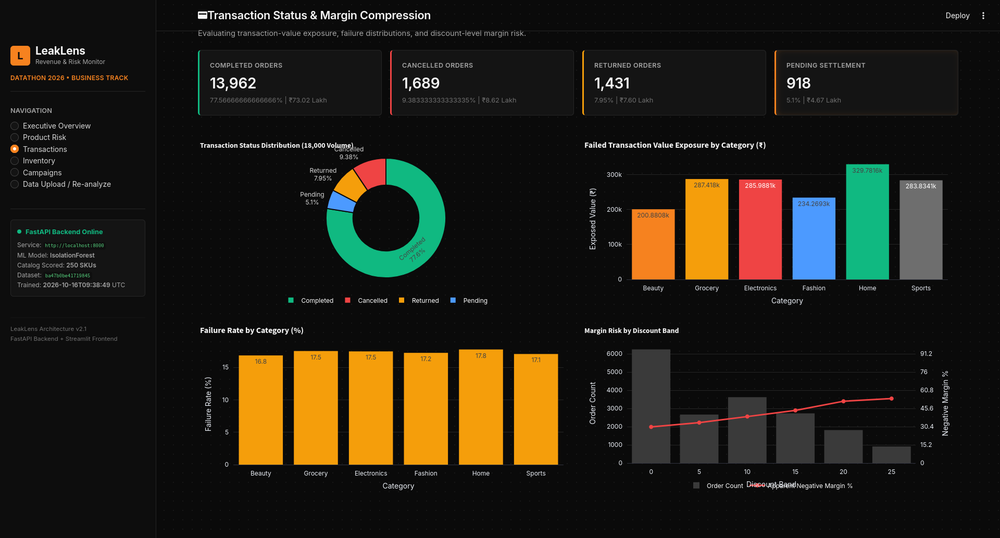
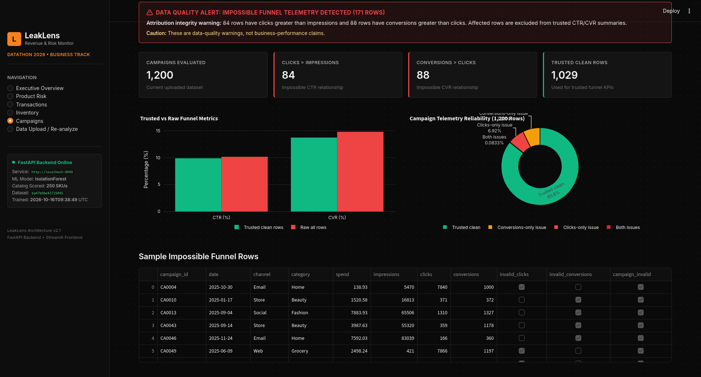
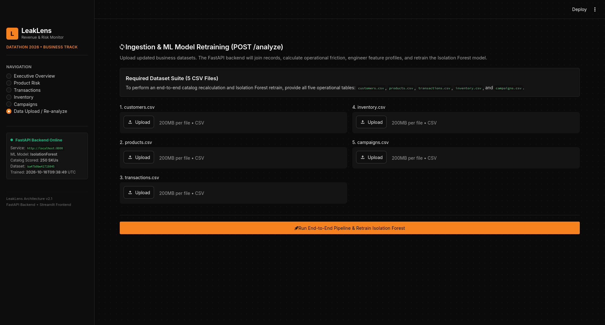

# LeakLens









**Explainable Revenue and Operational Risk Monitoring for Retail Data**

LeakLens is a decision-support platform developed for the **DATATHON 2026 Business Track: “The Money Leak.”**

The system analyzes transactional, product, inventory, customer, and campaign data to identify unusual business behavior, surface data-quality problems, prioritize areas that deserve managerial attention, and explain why a particular product or operational signal has been flagged.

Rather than attempting to predict an exact future monetary loss, LeakLens focuses on a more practical question:

> **What should a manager investigate first, and why?**

---

## Overview

Modern businesses typically have access to large amounts of operational data, but the information is often distributed across separate systems and dashboards.

A manager may need to inspect:

- transaction performance
- cancellations and returns
- product pricing and margins
- discount behavior
- inventory levels
- stockout signals
- supplier delays
- marketing campaign performance
- data-quality inconsistencies

Each metric can be useful independently, but manually combining them to identify the most important issue can be slow and difficult.

LeakLens converts these fragmented signals into a unified investigation workflow:

```text
Raw Business Data
        |
        v
Data Validation and Quality Checks
        |
        v
Business KPI Calculation
        |
        v
Product Feature Engineering
        |
        v
Isolation Forest Anomaly Detection
        |
        v
Business Priority Scoring
        |
        v
Explanations and Recommended Actions
        |
        v
Interactive Dashboard
```

The goal is not simply to display more charts.

The goal is to help a manager move from:

```text
"What happened?"
```

to:

```text
"What deserves attention first?"
"Why was it flagged?"
"What evidence supports the flag?"
"What should I investigate next?"
```

---

# Key Features

## 1. Product-Level Anomaly Detection

LeakLens uses an **Isolation Forest** model to detect products whose operational and financial behavior differs significantly from the rest of the product catalog.

The model is unsupervised because the dataset does not contain a reliable target label such as:

```text
is_money_leak
high_risk_product
future_loss
```

Instead, each product is transformed into a numerical behavioral profile and compared against other products in the catalog.

The model answers:

> **Which products exhibit statistically unusual combinations of business metrics?**

---

## 2. Business Priority Scoring

A statistically unusual product is not automatically the most important product for a manager.

For example:

```text
Product A
Anomaly score: very high
Transaction exposure: low

Product B
Anomaly score: moderately high
Transaction exposure: very high
```

A manager may reasonably investigate Product B first.

LeakLens therefore separates:

### ML anomaly detection

Answers:

> Is this product statistically unusual?

### Business priority

Answers:

> How urgently should this product be investigated?

The current priority score combines:

- anomaly strength
- transaction-value exposure
- apparent negative-margin exposure
- cancelled/returned transaction-value exposure
- operational risk signals

This produces a manager-facing investigation ranking that is separate from the raw Isolation Forest output.

---

# Dataset

LeakLens analyzes five business datasets.

| Dataset            | Purpose                                                                                     |
| ------------------ | ------------------------------------------------------------------------------------------- |
| `customers.csv`    | Customer region, segment, signup information, and preferred channels                        |
| `products.csv`     | Product category, unit cost, list price, and supplier lead time                             |
| `transactions.csv` | Orders, quantity, selling price, discounts, transaction status, channel, and payment method |
| `inventory.csv`    | Stock levels, reorder thresholds, stockout flags, and supplier delays                       |
| `campaigns.csv`    | Marketing spend, impressions, clicks, conversions, channel, and category                    |

The supplied DATATHON dataset contains:

| Dataset      |       Rows |
| ------------ | ---------: |
| Customers    |      3,000 |
| Products     |        250 |
| Transactions |     18,000 |
| Inventory    |      5,000 |
| Campaigns    |      1,200 |
| **Total**    | **27,450** |

---

# Data Processing Pipeline

## Step 1: Schema Validation

Before analysis begins, LeakLens validates that all required columns are present.

Examples include:

```text
customers:
customer_id
region
customer_segment
signup_date
preferred_channel
```

```text
products:
product_id
category
unit_cost
list_price
supplier_lead_days
```

```text
transactions:
transaction_id
customer_id
product_id
timestamp
quantity
unit_price
discount_pct
status
channel
payment_method
```

Additional validation checks include:

- duplicate identifiers
- invalid foreign keys
- negative prices
- negative costs
- non-positive transaction quantities
- invalid discount percentages
- negative inventory values
- invalid transaction status values
- negative campaign metrics

Fatal validation problems prevent analysis from continuing.

Non-fatal inconsistencies are retained but surfaced as data-quality warnings.

---

# Business KPI Engine

LeakLens calculates business-facing metrics before performing anomaly detection.

Examples include:

- total transaction value
- cancellation rate
- return rate
- combined cancellation/return exposure
- average discount
- estimated transaction margin
- apparent negative-margin rate
- stockout rate
- supplier delay
- inventory inconsistencies
- category-level margin behavior

---

## Transaction Value

Transaction value is calculated as:

```text
revenue =
quantity × unit_price × (1 - discount_pct)
```

For example:

```text
Quantity:     5
Unit price:   100
Discount:     20%

Revenue:
5 × 100 × 0.80 = 400
```

---

## Estimated Margin

Estimated transaction cost is calculated using the product's supplied unit cost:

```text
estimated_cost =
quantity × unit_cost
```

Estimated margin is then:

```text
estimated_margin =
revenue - estimated_cost
```

A transaction is marked as having an apparent negative margin when:

```text
estimated_margin < 0
```

These values should be interpreted carefully.

The supplied dataset documentation indicates that cost and pricing values may contain synthetic or unrealistic relationships. LeakLens therefore treats these values as:

> **pricing and margin-risk indicators requiring verification**

rather than confirmed accounting losses.

---

# Transaction Exposure

Cancelled and returned orders are treated as transaction-value exposure.

```text
combined_exposure =
cancelled_transaction_value
+
returned_transaction_value
```

This does not imply that the full value represents realized financial loss.

Instead, it identifies business activity associated with operational friction and therefore worth investigating.

---

# Data Quality Engine

LeakLens does not assume that every record in the source data is trustworthy.

Several logical checks are performed before metrics are interpreted.

---

## Campaign Funnel Validation

A normal digital marketing funnel generally follows:

```text
Impressions
    |
    v
Clicks
    |
    v
Conversions
```

Therefore, records such as:

```text
clicks > impressions
```

or:

```text
conversions > clicks
```

are flagged as inconsistent.

The original dataset includes campaign records exhibiting these impossible funnel relationships.

LeakLens surfaces them as data-quality issues rather than blindly using them for CTR or conversion-rate calculations.

---

## Inventory Validation

Inventory records are checked for contradictions such as:

```text
stockout_flag = 1
while
stock_on_hand > reorder_threshold
```

and:

```text
stock_on_hand = 0
while
stockout_flag = 0
```

These records may indicate logging, ETL, business-rule, or semantic inconsistencies.

LeakLens reports them separately so managers do not automatically interpret every stockout flag as a verified physical stockout.

---

# Product Feature Engineering

The machine-learning model does not operate directly on thousands of raw transaction and inventory records.

Instead, LeakLens aggregates the datasets into:

```text
one row per product
```

Each product becomes a behavioral profile.

The production model currently uses **14 numerical ML features**.

---

## Transaction Features

### `transaction_count`

Number of transactions involving the product.

### `avg_order_value`

Average discounted transaction value.

### `avg_discount`

Average discount applied to the product.

### `cancel_rate`

Percentage of product transactions that were cancelled.

### `return_rate`

Percentage of product transactions that were returned.

### `negative_margin_rate`

Fraction of transactions for the product with an apparent negative estimated margin.

### `avg_margin`

Average estimated transaction margin.

---

## Inventory Features

### `avg_stock_on_hand`

Average inventory level for the product.

### `avg_reorder_threshold`

Average reorder threshold.

### `stockout_rate`

Fraction of inventory records marked as stockouts.

### `avg_supplier_delay`

Average recorded supplier delay.

### `stockout_inconsistency_rate`

Fraction of inventory records where a stockout is reported despite inventory remaining above the reorder threshold.

---

## Product Features

### `supplier_lead_days`

Supplier lead time associated with the product.

### `base_margin_pct`

Relationship between supplied list price and supplied unit cost.

Calculated as:

```text
base_margin_pct =
(list_price - unit_cost) / unit_cost
```

---

# Why 14 Features?

Earlier versions of LeakLens included:

```text
cancel_rate
return_rate
failure_rate
```

as separate ML features.

However:

```text
failure_rate =
cancel_rate + return_rate
```

meaning the third feature was mathematically redundant.

The current model therefore excludes `failure_rate` from the ML input while still calculating and displaying it as a useful business KPI.

This reduces unnecessary feature duplication.

---

# Machine Learning Model

LeakLens uses:

```text
Isolation Forest
```

from `scikit-learn`.

Current configuration:

```python
IsolationForest(
    n_estimators=300,
    contamination=0.10,
    random_state=42
)
```

---

## Why Isolation Forest?

The dataset does not contain reliable labels such as:

```text
good_product = 0
bad_product = 1
```

or:

```text
money_leak = yes/no
```

Training a supervised classifier would therefore require creating artificial labels.

Instead, Isolation Forest learns the distribution of product behavior and identifies products that require fewer random partitions to isolate from the rest of the data.

Those products are treated as anomalous.

---

# Model Output

The Isolation Forest produces several internal signals.

## Anomaly Label

```text
1  = relatively normal product profile
-1 = anomalous product profile
```

With:

```text
contamination = 0.10
```

approximately 10% of the 250 products are expected to be marked as anomalies.

This corresponds to approximately:

```text
25 anomalous products
```

for the supplied dataset.

---

## Anomaly Score

The raw Isolation Forest decision score is transformed so that:

```text
higher value = more unusual product
```

LeakLens then normalizes the value for presentation.

This score indicates relative unusualness.

It is not:

```text
a probability of financial loss
a forecast of future revenue
a probability of cancellation
a guaranteed indicator of unprofitability
```

---

# Explainability Layer

A raw anomaly score alone is not useful to most managers.

LeakLens therefore adds a business interpretation layer.

For every product, the system compares its metrics against catalog-level baselines and identifies its strongest deviations.

Examples may include:

```text
Negative-margin rate
Product: 68%
Catalog median: 34%

Supplier delay
Product: 14.1 days
Catalog median: 7.8 days

Stockout rate
Product: 29%
Catalog median: 11%
```

The dashboard uses these deviations to generate explanations such as:

```text
High apparent negative-margin rate

High average discount

Elevated cancellation/return behavior

High supplier delay

High stockout rate

Weak supplied price-cost margin
```

These explanations provide context around a model flag.

They should not be interpreted as formal causal explanations of the Isolation Forest decision.

---

# Recommended Actions

LeakLens also maps business conditions to suggested investigation steps.

Examples include:

```text
Review pricing and discount rules
```

```text
Investigate cancellations and returns
```

```text
Review inventory policy
```

```text
Review supplier reliability
```

```text
Verify supplied cost and list-price data
```

These are intended as investigation recommendations rather than automated business decisions.

---

# Model Diagnostics

Because LeakLens uses unsupervised learning, conventional supervised metrics such as accuracy, precision, recall, or ROC-AUC are not appropriate without trustworthy ground-truth labels.

Instead, the system evaluates model robustness using stability diagnostics.

These include:

- anomaly count
- top-ranked product stability
- anomaly-set stability across random seeds
- contamination sensitivity
- feature count
- product count

The current supplied dataset produces approximately:

```text
Products analyzed:          250
Isolation Forest anomalies: 25
ML features:                14
```

The project also evaluates the degree to which top-ranked products remain consistent across different model seeds.

---

# Architecture

LeakLens uses a lightweight local architecture.

```text
                    +-----------------------+
                    |       CSV Files       |
                    |-----------------------|
                    | Customers             |
                    | Products              |
                    | Transactions          |
                    | Inventory             |
                    | Campaigns              |
                    +-----------+-----------+
                                |
                                v
                    +-----------------------+
                    |    FastAPI Backend    |
                    +-----------+-----------+
                                |
               +----------------+----------------+
               |                                 |
               v                                 v
    +-----------------------+         +-----------------------+
    | Data Validation       |         | Data Quality Checks   |
    +-----------------------+         +-----------------------+
               |
               v
    +-----------------------+
    | KPI Calculation       |
    +-----------------------+
               |
               v
    +-----------------------+
    | Product Feature       |
    | Engineering           |
    +-----------------------+
               |
               v
    +-----------------------+
    | Isolation Forest      |
    +-----------------------+
               |
               v
    +-----------------------+
    | Priority Scoring      |
    +-----------------------+
               |
               v
    +-----------------------+
    | Explanation Layer     |
    +-----------------------+
               |
               v
    +-----------------------+
    | JSON API              |
    +-----------+-----------+
                |
                v
    +-----------------------+
    | Streamlit Dashboard   |
    +-----------------------+
```

---

# Technology Stack

## Backend

- Python
- FastAPI
- Pandas
- NumPy
- scikit-learn
- Uvicorn

## Frontend

- Streamlit
- Plotly
- Requests

## Machine Learning

- Isolation Forest
- product-level feature engineering
- unsupervised anomaly detection
- stability diagnostics

---

# Dashboard

The Streamlit interface contains multiple investigation views.

## Executive Overview

Displays headline metrics including:

- total transaction value
- cancelled and returned exposure
- apparent negative-margin rate
- high-priority products
- major data-quality concerns

---

## Transaction Analysis

Provides:

- transaction status distribution
- transaction-value exposure
- discount behavior
- margin behavior
- category-level comparisons

All metrics are generated dynamically from the currently loaded backend dataset.

---

## Product Risk

Displays the ranked product catalog.

Users can:

- filter by category
- filter by priority level
- search by product ID
- inspect anomaly scores
- inspect priority scores
- inspect supporting business metrics
- view suggested investigation actions

---

## Product Drilldown

A selected product can be examined in more detail.

The drilldown includes:

- product information
- transaction behavior
- margin behavior
- inventory behavior
- supplier behavior
- ML anomaly status
- anomaly score
- priority score
- strongest deviations
- explanation text
- recommended investigation

---

## Campaign Data Quality

Highlights:

- invalid campaign funnel records
- clicks exceeding impressions
- conversions exceeding clicks
- trusted performance metrics derived from logically valid records

---

## Inventory Data Quality

Highlights:

- inconsistent stockout flags
- zero-stock records without stockout flags
- supplier delay behavior
- inventory telemetry problems

---

## Upload and Re-Analyze

LeakLens supports replacing all five source datasets through the interface.

When new files are uploaded:

```text
1. Schema validation runs
2. Data-quality checks run
3. Tables are joined
4. KPIs are recalculated
5. Product features are regenerated
6. Isolation Forest is retrained
7. Anomaly scores are regenerated
8. Priority scores are regenerated
9. Explanations are regenerated
10. Dashboard data is refreshed
```

The application therefore does not rely on a static exported analysis.

---

# API

The FastAPI backend exposes the analysis through HTTP endpoints.

## Health

```http
GET /health
```

Returns backend and analysis status.

---

## Overview

```http
GET /overview
```

Returns headline business KPIs.

---

## Metadata

```http
GET /metadata
```

Returns information about:

- model
- dataset
- feature count
- product count
- training mode
- training timestamp
- dataset fingerprint

---

## Product Risk Ranking

```http
GET /products/risk
```

Optional filters include:

```text
category
priority_level
limit
```

---

## Product Drilldown

```http
GET /products/{product_id}
```

Returns a detailed product profile.

---

## Category Analysis

```http
GET /categories
```

Returns category-level margin and transaction behavior.

---

## Transaction Summary

```http
GET /transactions/summary
```

Returns dynamically calculated transaction metrics.

---

## Campaign Quality

```http
GET /quality/campaigns
```

Returns campaign data-quality information and invalid records.

---

## Inventory Quality

```http
GET /quality/inventory
```

Returns inventory consistency information.

---

## Model Diagnostics

```http
GET /diagnostics/model
```

Returns unsupervised model diagnostics and robustness information.

---

## Validation

```http
GET /validation
```

Returns validation results for the currently loaded dataset.

A dataset can also be validated before replacing the active analysis.

```http
POST /validate
```

---

## Analyze New Dataset

```http
POST /analyze
```

Requires all five CSV files:

```text
customers
products
transactions
inventory
campaigns
```

The endpoint validates the incoming data, rebuilds the product profiles, retrains Isolation Forest, recalculates the business-priority ranking, and replaces the current in-memory analysis state.

---

# Installation

Clone the repository:

```bash
git clone https://github.com/DeployedReject/LeakLens
cd leaklens
```

Create a virtual environment:

```bash
python -m venv .venv
```

Activate it.

Linux/macOS:

```bash
source .venv/bin/activate
```

Windows PowerShell:

```powershell
.venv\Scripts\Activate.ps1
```

Install dependencies:

```bash
pip install -r requirements.txt
```

---

# Running LeakLens

The simplest method is to use the unified launcher:

```bash
python run_services.py
```

This starts:

```text
FastAPI backend:
http://localhost:8000

Streamlit dashboard:
http://localhost:8501
```

FastAPI interactive documentation is available at:

```text
http://localhost:8000/docs
```

---

# Running Services Manually

## Backend

From the backend directory:

```bash
cd backend
uvicorn app:app --host 0.0.0.0 --port 8000
```

---

## Frontend

In another terminal:

```bash
cd frontend
streamlit run app.py --server.port 8501
```

---

# Project Structure

```text
leaklens/
|
├── run_services.py
├── requirements.txt
├── README.md
|
├── backend/
│   ├── analysis.py
│   ├── app.py
│   ├── requirements.txt
│   │
│   └── data/
│       ├── customers.csv
│       ├── products.csv
│       ├── transactions.csv
│       ├── inventory.csv
│       └── campaigns.csv
|
├── frontend/
│   ├── app.py
│   ├── api_client.py
│   ├── style.css
│   │
│   ├── pages_modules/
│   │   ├── overview.py
│   │   ├── transactions.py
│   │   ├── products.py
│   │   ├── inventory.py
│   │   ├── campaigns.py
│   │   ├── anomalies.py
│   │   └── upload.py
│   │
│   └── utils/
│       ├── components.py
│       └── formatting.py
|
├── tests/
│   ├── test_analysis.py
│   └── test_api.py
|
└── dev_tools/
    └── generate_data.py
```

The development data generator is kept outside the production analysis path and is not used as a substitute for the supplied competition dataset.

---

# Testing

The project includes automated tests covering:

- schema validation
- invalid values
- foreign-key integrity
- anomaly generation
- business-priority generation
- API health
- product lookup
- invalid product requests
- analysis replacement
- upload validation

Run the test suite with:

```bash
pytest
```

Current hardened build:

```text
8 tests passed
```

---

# Example Analysis Flow

Suppose a product has:

```text
High apparent negative-margin rate
High average discount
Above-normal supplier delay
Moderate cancellation rate
High transaction-value exposure
```

Isolation Forest may identify the combination as statistically unusual.

LeakLens then evaluates its business exposure and produces a result conceptually similar to:

```text
Product:
PR0127

ML anomaly:
Yes

Anomaly score:
High relative deviation

Business priority:
High

Primary signals:
- Negative-margin behavior significantly above catalog baseline
- Supplier delay above catalog median
- High transaction-value exposure

Recommended investigation:
- Verify product cost data
- Review discount rules
- Review supplier reliability
```

The system therefore connects:

```text
Detection
→ Evidence
→ Priority
→ Action
```

rather than stopping at an anomaly score.

---

# Interpretation of Results

LeakLens is designed as a **decision-support tool**, not an autonomous decision-making system.

Several important distinctions apply.

## Anomaly does not mean loss

Isolation Forest determines whether a product behaves unusually relative to the rest of the catalog.

It does not determine whether that behavior has definitively caused financial loss.

---

## Priority is not probability

A priority score indicates relative investigation urgency.

For example:

```text
Priority score = 85
```

does not mean:

```text
85% probability of loss
```

---

## Margin values require verification

Because the dataset may contain synthetic or unrealistic cost-price relationships, apparent negative margins should be validated using real accounting or supplier information before business decisions are made.

---

## Data-quality warnings matter

Campaign and inventory inconsistencies may originate from:

- ETL errors
- incorrect logging
- schema interpretation problems
- source-system inconsistencies
- synthetic dataset artifacts

LeakLens therefore surfaces these problems rather than silently treating all records as trustworthy.

---

# Current Dataset Findings

Using the supplied DATATHON dataset, LeakLens identifies several investigation-worthy signals.

Examples include:

- approximately 17.33% of transactions are cancelled or returned
- approximately ₹16.22 lakh in cancelled/returned transaction-value exposure
- approximately 37.94% of transactions show an apparent negative estimated margin
- the Beauty category exhibits particularly strong apparent margin-risk behavior
- campaign records contain impossible funnel relationships
- inventory records contain contradictory stockout telemetry
- approximately 10% of product profiles are identified as Isolation Forest anomalies

These findings represent investigation signals rather than confirmed financial losses.

---

# Design Principles

LeakLens was built around several principles.

## Explainability before complexity

A simpler model that can be clearly understood is preferable to an opaque model that cannot be defended.

---

## No fabricated labels

The system does not invent artificial ground-truth labels in order to train a supervised classifier.

---

## Separate statistical anomaly from business importance

Being unusual does not necessarily mean being important.

LeakLens therefore evaluates business impact separately.

---

## Surface bad data instead of hiding it

Data-quality problems are part of the analysis.

A manager should know when a KPI is derived from questionable source information.

---

## Recommendations remain advisory

LeakLens recommends what to investigate.

It does not automatically change prices, cancel campaigns, reorder inventory, or penalize suppliers.

---

# Limitations

LeakLens currently has several limitations.

## Synthetic or educational data

The DATATHON dataset may contain intentionally artificial relationships.

Results should therefore be interpreted as analytical signals rather than real commercial conclusions.

---

## No causal inference

Isolation Forest identifies unusual behavior.

It does not prove why that behavior occurred.

---

## Product-level aggregation

The model currently operates primarily on product-level profiles.

Future versions could incorporate:

- customer-level anomaly detection
- time-series anomalies
- regional anomalies
- supplier-level profiles
- campaign-level anomaly models

---

## Relative anomaly scoring

Isolation Forest scores depend on the current catalog distribution.

A product considered unusual in one dataset may not be unusual in a different business environment.

---

## In-memory analysis state

The current application prioritizes simplicity for the datathon prototype.

A production implementation would likely require:

- database-backed persistence
- user authentication
- model versioning
- audit logging
- historical analysis records
- scheduled ingestion

---

# Future Work

Potential future improvements include:

## Time-Series Monitoring

Track risk metrics over time rather than analyzing only the current snapshot.

---

## Historical Model Comparison

Compare current product behavior against previous model runs.

---

## Manager Feedback Loop

Allow managers to classify flagged products as:

```text
Useful alert
False positive
Already known
Resolved
```

This feedback could eventually support semi-supervised learning.

---

## Automated Alerting

Generate alerts when:

- a product enters the anomaly set
- priority changes significantly
- supplier delay increases
- negative-margin exposure exceeds a threshold
- campaign data becomes inconsistent

---

## Persistent Analysis History

Store:

- dataset fingerprints
- model versions
- anomaly sets
- priority rankings
- validation results
- timestamps

---

## Production Data Connectors

Replace CSV ingestion with integrations such as:

- relational databases
- warehouse systems
- ERP platforms
- marketing APIs
- inventory management systems

---

# Datathon Context

LeakLens was created for:

```text
DATATHON 2026
Business Track
"The Money Leak"
```

The challenge focuses on using business data to identify potential revenue or operational problems, investigate likely drivers, and support better managerial decision-making.

LeakLens approaches this by combining:

```text
Business KPIs
+
Data Quality Validation
+
Unsupervised Machine Learning
+
Business Impact Prioritization
+
Explainable Recommendations
```

into a single investigation workflow.

---

# Core Idea

The central idea behind LeakLens can be summarized as:

> **LeakLens converts fragmented business data into an explainable, prioritized manager action queue.**

Instead of presenting managers with another dashboard full of disconnected charts, the system attempts to answer four questions:

```text
What looks wrong?

Why was it flagged?

What evidence supports the finding?

What should be investigated next?
```

---

# Disclaimer

LeakLens is a prototype decision-support system developed for a datathon and educational analysis.

Its anomaly scores, priority scores, estimated margins, exposure figures, and recommended actions should not be interpreted as audited financial results or automated business decisions.

Real-world deployment would require validation against trusted operational, accounting, campaign, inventory, and supplier data.
